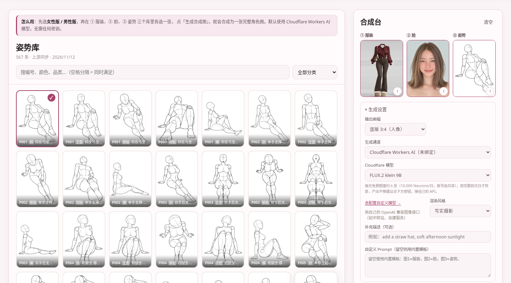
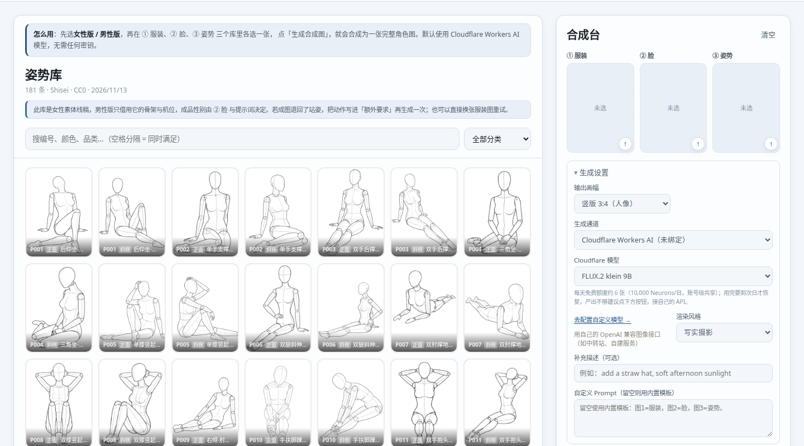

# AI角色合成工坊

**服装、脸型、姿势，合成一个完整的 AI 角色。**

从三个素材库各选一张，点一次生成，得到「穿着这件衣服、长这张脸、摆这个姿势」的成品图。
纯静态前端 + Cloudflare Worker，零框架、零构建；部署到 Cloudflare 就能直接调用 Workers AI，
不需要任何 API Key。

[图文教程](https://blog.1day.vip/post/ai-character-atelier) · [详细说明](docs/manual.md)



## 效果

四步，都在同一个页面上完成：

| 步骤 | 做什么 | 素材长什么样 |
|---|---|---|
| ① 服装 | 选一套衣服 | 无头人台图，只取衣料 |
| ② 脸 | 选一张脸 | 正面大头照，只取五官与发型 |
| ③ 姿势 | 选一个动作 | 线稿人偶，只取骨架与机位 |
| ④ 生成 | 点「生成合成图」 | 10–30 秒出成品 |

## 两个版本

顶部一键切换，默认女性版；切换会同时换掉**整套配色**和**三库素材**。

| | 女性版（粉） | 男性版（蓝） |
|---|---|---|
| 服装 | 1,542 套 | 254 套 |
| 脸型 | 893 张 | 48 张 |
| 姿势 | 567 个 | 181 个 |

男性素材偏少：脸型是本站生成的 48 张，姿势借的是女性素体线稿（只取骨架，不取轮廓）。
素材来源与授权见[文档](docs/manual.md#功能与素材)。



## 部署

两条路，选一条。本项目**没有构建步骤**：`wrangler.jsonc` 里 `assets.directory` 直接指向
`web/public`，Cloudflare 拿到仓库就能跑。

### 方式一：连 GitHub 仓库（推荐，全程浏览器）

不用装环境，不用写代码。

1. **Fork**：打开 [github.com/haihaipypy/atelier](https://github.com/haihaipypy/atelier)，点右上角
   **Fork**。Cloudflare 只能连你自己账号里的仓库，这一步不能省。
2. **建 Worker**：Dashboard → **Workers & Pages → Create application** → 选 **GitHub**
   （不要选 Hello World 模板），授权后从列表里选中 `atelier`。
3. **Project name 填 `atelier-compose`**：必须和 `wrangler.jsonc` 的 `name` 字段一致，
   不一致构建会直接失败。Deploy command 保持默认的 `npx wrangler deploy`。
4. **Save and Deploy**，等 1–2 分钟。
5. **看绑定**：Worker → **Settings → Bindings**，应看到 `ASSETS`、`AI`、`CONFIG` 三项。
   KV 由 Cloudflare 在部署时自动建档，不用手建、不用填 ID。
6. **访问**：`https://atelier-compose.<你的子域>.workers.dev`。想绑自有域名：
   **Settings → Domains & Routes → Add custom domain**。

构建报错对照表、KV 为什么不用管、变量和绑定的区别，都在[部署细节](docs/manual.md#部署细节)。

### 方式二：本地 wrangler CLI

```bash
git clone https://github.com/haihaipypy/atelier.git
cd atelier && npm install
npx wrangler login
npx wrangler deploy
```

两种方式别混用：Worker 已经连了 Git，再用 CLI 部署会顶掉控制台那套构建设置。

## 使用

1. 先选**女性版**或**男性版**；
2. 在 ① 服装、② 脸、③ 姿势 三个库里各选一张：点卡片弹大图，看清后点「确认选择」；
3. 可选：展开「生成设置」，调画幅、渲染风格、模型，或写补充描述；
4. 点「生成合成图」，出图后可下载。底部会显示所用模型与耗时。

任一槽位都可以「手动上传」自己的图片，也可以在「自定义提示词」里放任意三张图做合并。

## 免费额度

默认走 Cloudflare Workers AI，消耗你自己账号的额度，**不用绑卡**：

**每天 10,000 Neurons，UTC 0 点重置（北京时间早上 8 点）。**

| 模型 | 每张 1024² 消耗 | 免费额度约能出 |
|---|---|---|
| `flux-2-klein-9b`（默认） | ≈1.5k Neurons（含 3 张参考图） | **约 6 张/天** |
| `flux-2-klein-4b` | ≈1k Neurons | 约 10 张/天 |
| `flux-2-dev` | 按步计费，最贵 | 2–3 张/天 |

额度不够、或者想要更稳的坐姿效果，就接自己的模型：页面「去配置自定义模型 →」，
填 OpenAI 兼容的 Base URL 与 Key。**默认浏览器直连**，密钥只存在本机，不经过本站。

配额怎么算、报错怎么读、403 为什么多半是出口 IP 被拦，见
[免费额度与模型](docs/manual.md#免费额度与模型)。

## 更多玩法

- 补充描述、换渲染风格（写实摄影 / 二次元插画）、换画幅（3:4 / 1:1 / 9:16 / 4:3）
- 任意三张图合并，不限于图库素材
- 男性版姿势不生效时，把动作写进补充描述再生成一次

## 文档

| 文档 | 内容 |
|---|---|
| [详细说明](docs/manual.md) | 部署细节、参数、额度与错误码、图库同步、API、版权、验证状态 |
| [图文教程](https://blog.1day.vip/post/ai-character-atelier) | 从 Fork 到部署的完整流程，含实测效果 |
| [第三方素材声明](THIRD-PARTY-NOTICES.md) | 每个上游图库的授权与使用边界 |

## 许可

代码 [MIT](LICENSE) © 2026 无辣 · [www.1day.vip](https://www.1day.vip)
